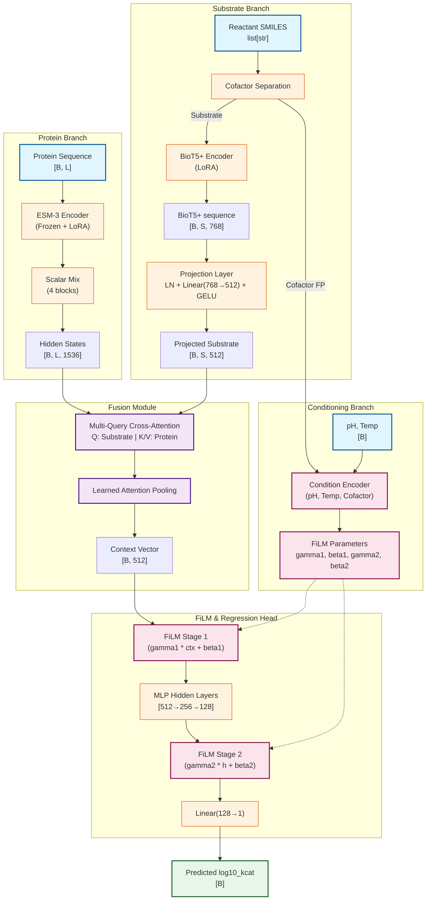

# K-ICM Predictor (Phase E Architecture)

Predict enzyme kinetic parameters ($k_{cat}$, log10 target) from protein sequence and substrate SMILES with pH and temperature conditioning.

This repository implements the **Phase E** architecture. It relies on a frozen ESM-3 protein encoder with LoRA adapters (Multi-scale Scalar Mix), a trainable BioT5+ substrate encoder (with LoRA), Multi-Query Cross-Attention fusion, and double-stage FiLM conditioning for pH, temperature, and cofactors.

---

## 1. Quick Start & Launch Reference

### Setup
```bash
conda activate kicmv2
pip install -r requirements.txt
```

### Training (4×GPU DDP, Phase E)
```bash
CUDA_VISIBLE_DEVICES=0,1,2,3 \
  PYTORCH_CUDA_ALLOC_CONF=expandable_segments:True \
  conda run --no-capture-output -n kicmv2 \
  torchrun --nproc_per_node=4 train.py \
    --config configs/train_config.yaml \
    2>&1 | tee training.log
```

### Fast Dev Run / Debugging
```bash
# Single process, 1 batch
conda run --no-capture-output -n kicmv2 python train.py --config configs/train_config.yaml --fast_dev_run

# DDP 2-GPU (catches DDP bugs)
CUDA_VISIBLE_DEVICES=0,1 conda run --no-capture-output -n kicmv2 torchrun --nproc_per_node=2 train.py --config configs/train_config.yaml --fast_dev_run
```

### Evaluation & OOD Analysis
```bash
# Standard evaluation
conda run --no-capture-output -n kicmv2 python evaluate.py \
    --config configs/train_config.yaml \
    --checkpoint outputs/checkpoints/best.ckpt \
    --test-csv data/test.csv

# OOD Evaluation (CD-HIT cluster-based)
conda run --no-capture-output -n kicmv2 python evaluate_ood.py \
    --results_csv outputs/test_predictions.csv \
    --train_csv data/train.csv \
    --threshold 20 40 60 80 99
```

### Testing
```bash
# Phase E smoke test
conda run --no-capture-output -n kicmv2 python smoke_test.py

# Full pytest suite (79 Phase E tests + 17 D2 tests)
pytest tests/
```

---

## 2. Architecture & Data Flow



---

## 3. Training Configuration & Param Groups

Phase E introduces multi-stage training configs, utilizing LoRA adapters on both the ESM-3 protein encoder and BioT5+ substrate encoder. Loss function is **Huber (delta=4.0)**.

**Optimizer:** AdamW (5 groups) + LambdaLR (Linear warmup → Cosine decay → 5% min floor)

| Group | LR | Weight Decay | Note |
|---|---|---|---|
| task_decay | 1.2e-4 | 1.5e-2 | Main task params (MLP, Proj, CA, Cond) |
| task_no_decay | 1.2e-4 | 0.0 | Biases, norms, layer_weights |
| biot5_decay | 1.5e-5 | 1.5e-2 | BioT5+ trainable params |
| biot5_no_decay | 1.5e-5 | 0.0 | BioT5+ trainable params (biases/norms) |
| esm3_lora | 5e-6 | 1.5e-2 | ESM3 LoRA adapters (when enabled) |

---

## 4. Data Format

CSV with columns:
- `sequence`: amino acid sequence (1-letter code)
- `reactant_smiles`: raw multi-component SMILES (substrate and cofactors)
- `log10_value`: target in log10 space
- `ph`: experimental pH value (NaN if missing)
- `temperature`: experimental temperature in Celsius (NaN if missing)

Validations such as `math.isnan` checks and dataset load-time filtering are applied. `KICMCollator` parses the `reactant_smiles` to safely separate substrates from cofactors (represented as Morgan fingerprints).

---

## 5. Project Structure

```text
kcat_predictor/
├── train.py                          # Lightning entry point
├── evaluate.py                       # Standalone checkpoint evaluation CLI
├── evaluate_ood.py                   # Post-hoc OOD evaluation CLI
├── smoke_test.py                     # Phase E smoke test (19 checks)
├── configs/
│   ├── train_config.yaml             # Phase E production config
│   └── train_probe.yaml              # Phase E probe config (2 epochs)
├── data/
│   ├── train.csv, val.csv, test.csv
│   └── train_probe.csv, val_probe.csv
├── src/
│   ├── models/
│   │   ├── esm3_encoder.py           # ESM-3 + LoRA + Scalar Mix
│   │   ├── biot5_encoder.py          # BioT5+ wrapper (SELFIES)
│   │   ├── cross_attention.py        # Multi-Query Cross Attention
│   │   ├── condition_encoder.py      # FiLM conditioning (pH, temp, cofactor)
│   │   ├── projection.py             # Linear + GELU projection
│   │   ├── mlp_head.py               # MLP regression head with residual
│   │   ├── kicm_model.py             # nn.Module assembly (Phase E)
│   │   └── kicm_module.py            # LightningModule, param groups
│   ├── data/
│   │   ├── dataset.py, collator.py, kicm_datamodule.py
│   │   └── cofactor_registry.py      # Data-driven cofactor whitelist
│   ├── training/
│   │   └── metrics.py                # R2, RMSE, MAE, PCC, SCC
│   ├── evaluation/
│   │   └── ood_evaluator.py          # CD-HIT cluster-based IID/OOD
│   ├── utils/
│   │   └── seed.py, logging_utils.py, config_validation.py
│   └── visualization/
│       └── plots.py, generate_plots.py
├── tests/
│   ├── test_d2.py                    # 17 Legacy D2 Tests
│   └── test_phase_e.py               # 79 Phase E tests
└── outputs/                          # Checkpoints, logs, plots
```

---

## 6. Baselines and Reference Points

| Run | val/test r2 | Note |
|---|---|---|
| C1 (DMPNN, bidirec) | 0.516 (test) | Baseline |
| D1 (Uni-Mol frozen) | 0.492 (test) | Frozen encoder failed |
| D2 Phase 1 (MoLFormer, ESM-3 frz) | 0.586 (val) | Legacy Architecture Peak |
| CatPred (Target) | 0.608 (test) | Publication target |

> **Deviations specific to Phase E:**
> Replaces MoLFormer with BioT5+ for substrate encoding to achieve per-token resolution. Introduces Multi-Query Cross-Attention and double-stage FiLM conditioning (incorporating pH, temperature, and separated cofactors). Uses Huber(delta=4.0) loss instead of MSE. Employs a robust Scalar Mix over ESM-3 final blocks. LoRA adapters configured on both encoders for optimal fine-tuning stability and performance.
