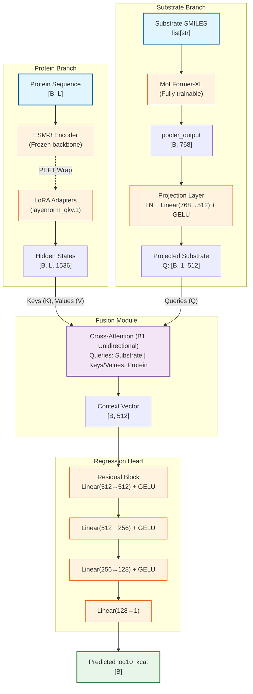

# K-ICM Predictor (D2 LoRA Architecture)

Predict enzyme kinetic parameters ($k_{cat}$, log10 target) from protein sequence and substrate SMILES.

This repository implements the **D2 LoRA Clean** architecture. It relies on a frozen ESM-3 protein encoder with LoRA adapters, a fully trainable MoLFormer-XL substrate encoder, and Cross-Attention fusion (B1 unidirectional).

---

## 1. Quick Start & Launch Reference

### Setup
```bash
conda activate kicmv2
pip install -r requirements.txt
```

### Training (2×GPU DDP, D2 LoRA)
```bash
CUDA_VISIBLE_DEVICES=2,3 \
  PYTORCH_CUDA_ALLOC_CONF=expandable_segments:True \
  conda run --no-capture-output -n kicmv2 \
  torchrun --nproc_per_node=2 train.py \
    --config configs/train_config.yaml \
    2>&1 | tee training.log
```

### Fast Dev Run / Debugging
```bash
# Single process, 1 batch
conda run --no-capture-output -n kicmv2 python train.py --config configs/train_config.yaml --fast_dev_run

# DDP 2-GPU (catches DDP bugs)
CUDA_VISIBLE_DEVICES=2,3 conda run --no-capture-output -n kicmv2 torchrun --nproc_per_node=2 train.py --config configs/train_config.yaml --fast_dev_run
```

### Evaluation & OOD Analysis
```bash
# Standard evaluation
conda run --no-capture-output -n kicmv2 python evaluate.py \
    --config configs/train_config.yaml \
    --checkpoint outputs/checkpoints/best.ckpt \
    --test-csv data/test.csv

# OOD Evaluation (CD-HIT cluster-based)
conda run --no-capture-output -n kicmv2 python evaluate_ood.py \
    --results_csv outputs/test_predictions.csv \
    --train_csv data/train.csv \
    --threshold 20 40 60 80 99
```

### Testing
```bash
# D2 LoRA smoke test
conda run --no-capture-output -n kicmv2 python smoke_test.py

# Full pytest suite (18 D2 LoRA tests)
pytest tests/test_d2.py
```

---

## 2. Architecture & Data Flow



---

## 3. Training Configuration & Param Groups

Instead of phase transitions, this architecture uses single-phase training with PEFT LoRA adapters protecting the protein encoder.

**Optimizer:** AdamW (5 groups) + LambdaLR (Linear warmup 100 steps → Cosine decay)

| Group | LR | Weight Decay |
|---|---|---|
| task_decay | 2e-4 | 1e-2 |
| task_no_decay | 2e-4 | 0.0 |
| molformer_decay | 2e-5 | 1e-2 |
| molformer_no_decay | 2e-5 | 0.0 |
| esm3_lora | 1e-5 | 1e-2 |

*Note: LoRA has no bias params, so no `esm3_lora_no_decay` group is needed.*

---

## 4. Data Format

CSV with columns:
- `sequence`: amino acid sequence (1-letter code, max 1024)
- `reactant_smiles`: substrate canonical SMILES
- `log10_value`: target in log10 space

Invalid SMILES, sequences > 1024 AA, and NaNs are automatically filtered at dataset load time.

---

## 5. Project Structure

```text
kcat_predictor/
├── train.py                          # Lightning entry point
├── evaluate.py                       # Standalone checkpoint evaluation CLI
├── evaluate_ood.py                   # Post-hoc OOD evaluation CLI
├── smoke_test.py                     # D2 LoRA smoke test
├── configs/
│   ├── train_config.yaml             # D2 LoRA production config
│   └── train_probe.yaml              # D2 LoRA probe config (6 epochs)
├── data/
│   ├── train.csv, val.csv, test.csv
├── src/
│   ├── models/
│   │   ├── esm3_encoder.py           # ESM-3 + LoRA
│   │   ├── molformer_encoder.py      # MoLFormer-XL wrapper
│   │   ├── cross_attention.py        # B1 unidirectional fusion only
│   │   ├── projection.py             # Linear + GELU projection
│   │   ├── mlp_head.py               # MLP regression head with residual
│   │   ├── kicm_model.py             # nn.Module assembly (D2 only)
│   │   └── kicm_module.py            # LightningModule, LoRA param groups
│   ├── data/
│   │   ├── dataset.py, collator.py, kicm_datamodule.py
│   ├── training/
│   │   └── metrics.py                # R2, RMSE, MAE, PCC, SCC
│   ├── evaluation/
│   │   └── ood_evaluator.py          # CD-HIT cluster-based IID/OOD
│   ├── utils/
│   │   └── seed.py, logging_utils.py, config_validation.py
│   └── visualization/
│       └── plots.py, generate_plots.py
├── tests/
│   └── test_d2.py                    # 18 D2 LoRA tests
└── outputs/                          # Checkpoints, logs, plots
```

---

## 6. Baselines and Reference Points

| Run | val/test r2 | Note |
|---|---|---|
| C1 (DMPNN, bidirec) | 0.516 (test) | Baseline |
| D1 (Uni-Mol frozen) | 0.492 (test) | Frozen encoder failed |
| D2 Phase 1 (MoLFormer, ESM-3 frozen) | 0.586 (val) | LoRA target must exceed this |
| CatPred (Target) | 0.608 (test) | Publication target |

> **Deviations specific to D2 LoRA:**
> All D1 code (DMPNN, UniMol, 3-phase Unfreezing, AttentivePooling) has been deprecated and removed. LoRA provides efficient fine-tuning without OOM risks. Huber beta reverted to 1.0. Cross-attention is locked to B1 unidirectional. Validation and Phase transitions removed.
